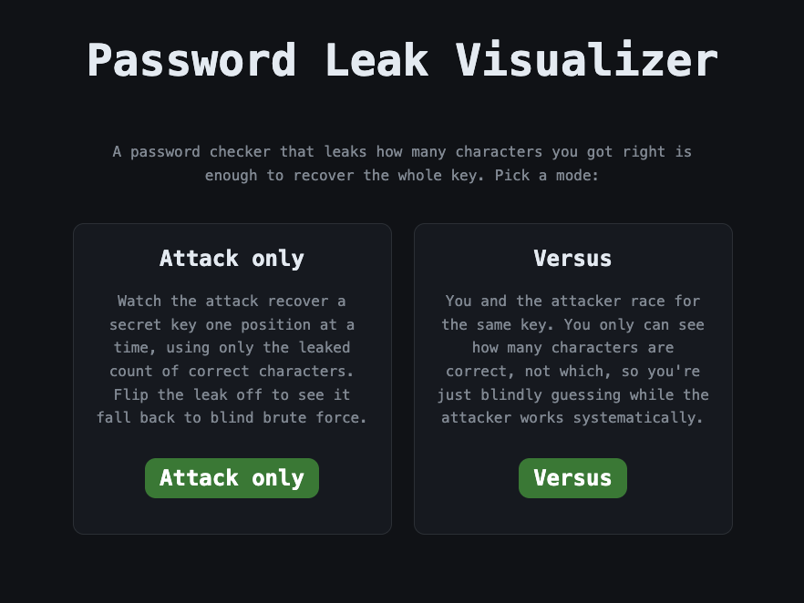
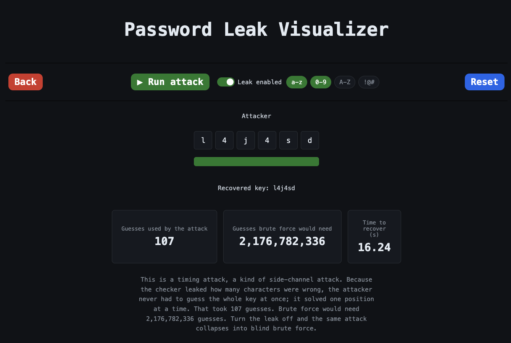
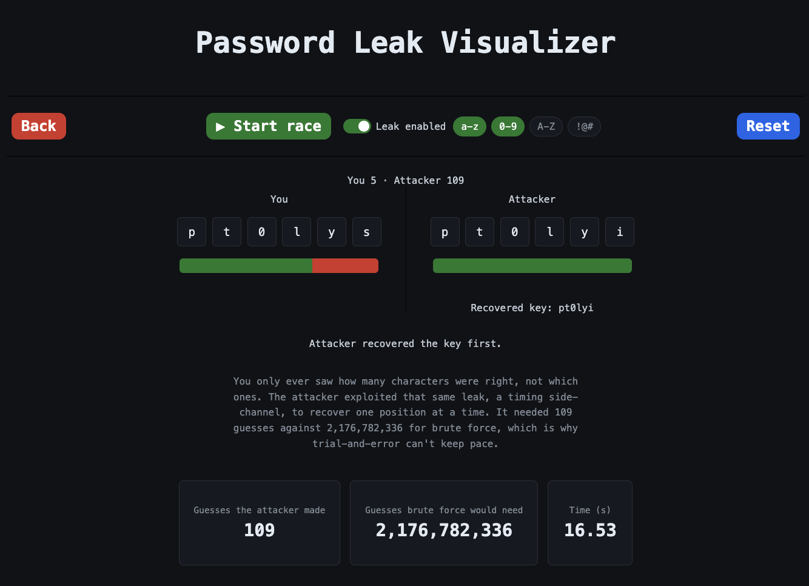

# Password Leak Visualizer

An interactive, browser-based demo of a **timing / side-channel attack**. A password checker that leaks *how many* characters of a guess are correct is enough for an attacker to recover the whole key one position at a time, instead of brute-forcing every combination. This interactive demo makes that leak visible.

**Course:** SE/CprE 4210 — Learning Sprint 3, Problem 5

**Team:** Hacker Team 8 (Sara Theriault)

## What it shows

A secret key is generated, and the only feedback available is the count of correct characters (never *which* ones). The systematic attack uses that count to lock in each position left to right, while brute force would have to search the entire space. The stats at the end of a run contrast the two: a couple hundred guesses for the leak-driven attack versus billions for brute force.

## Modes

- **Attack only** — Watch the attack recover a secret key one position at a time using only the leaked count. Turn the leak off and it collapses into blind brute force.
- **Versus** — You and the attacker race for the same key. You only ever see how many characters are right, not which, so you're guessing while the attack works systematically.

## Features

- **Leak toggle** — switch the side-channel on or off to compare the leak-driven attack against brute force.
- **Alphabet selection** — choose the character classes in play (a–z, 0–9, A–Z, symbols); the brute-force number updates to match.
- **Pause / resume** — halt and continue a running attack or race.
- **Live stats** — guesses used, guesses brute force would need, time to recover, and a running guess tally in Versus.

## Screenshots

Home page with the two game modes:

End of an Attack only run:

End of a Versus run:

## Running it

No build step. Open `index.html` in any modern browser.

## Files

- `index.html` — markup and structure
- `style.css` — styling
- `script.js` — attack logic, modes, and interactions